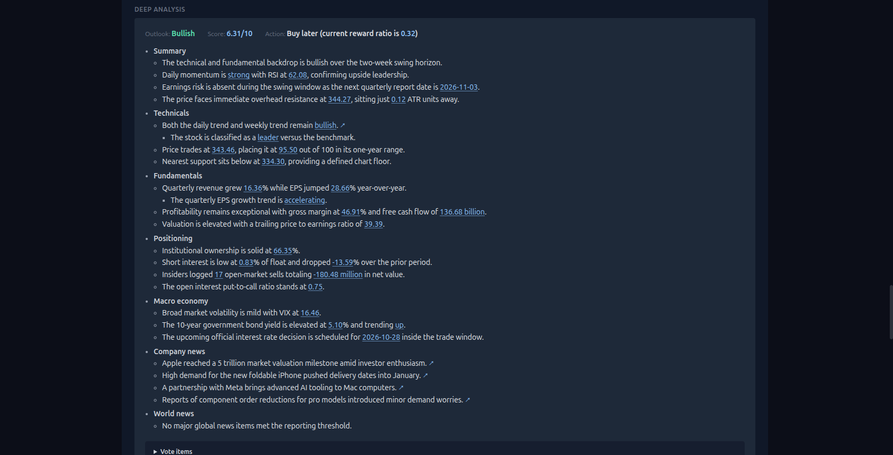
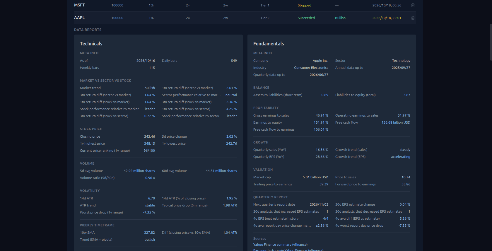
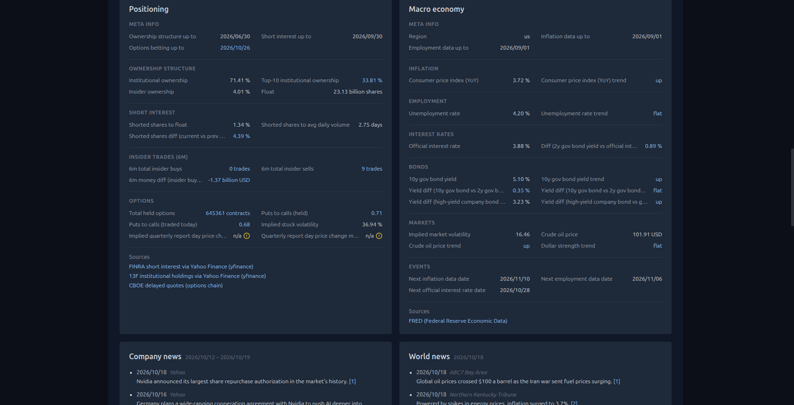
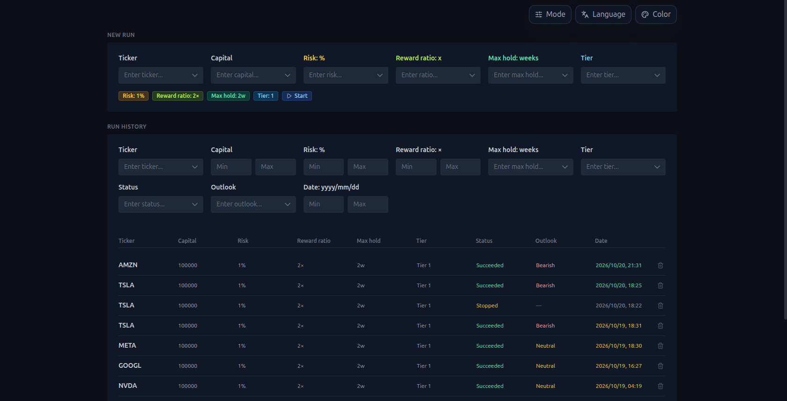
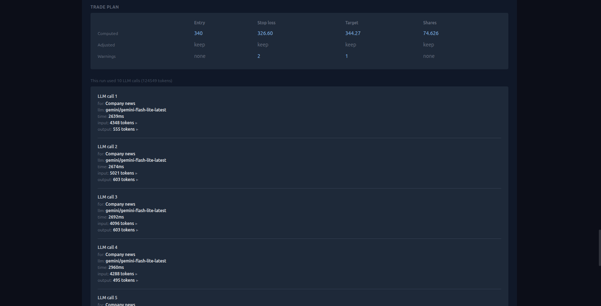
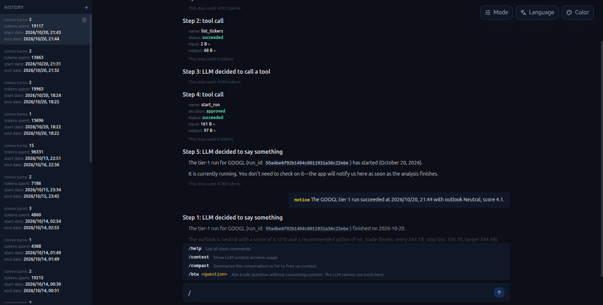

<div align="center">


# Custom Stock Analysis

**Type a ticker, get a structured report: six data reports, an outlook, and a sized trade plan. Then ask the chat bot about it.**

[](https://github.com/wenbo68/custom-stock-analysis/actions/workflows/ci.yml)
[](https://github.com/wenbo68/custom-stock-analysis/pkgs/container/custom-stock-analysis)
[](pyproject.toml)
[](LICENSE)
[](https://github.com/wenbo68/custom-stock-analysis)

Self-hosted. One person, one machine, your own model key. No sign-in.



</div>

---

## What it does

Enter a ticker, pick a tier and a maximum hold time, and the app runs a pipeline of data fetches and model calls that ends in one report:

- **Six data reports**, fetched from live sources and shown as tables with every number explained in plain words: technicals, fundamentals, positioning, macro economy, company news, world news.
- **An outlook** (bullish, bearish or neutral) with a score and the reasons, each reason citing the exact number in the report it rests on. Citations are checked by code, not trusted.
- **A trade plan**: entry, stop loss, target and share count sized from your capital and risk percent, then reviewed by the model with every adjustment explained.
- **Two tiers.** Tier 1 is a single preliminary analysis. Tier 2 is a deep analysis: several model roles list and grade the evidence, vote, and a deciding round settles it, with the whole vote tree open to inspection.
- **Cards as they land.** A running run's report fills in step by step: each data report appears the moment it is fetched, then the analysis, with the card in progress shown as a skeleton and the row's status counting the finished cards. The chat bot sees the same through its run tool.
- **A stop button** on every running run. The step in flight finishes (so the token totals match the bill), the rest is skipped, and the report keeps the sections that had finished.
- **A chat page** whose bot reads and acts on your run history through the app's own API: list runs, open a report, start, stop or delete a run. Every action asks you first and every model call is on the record. A run the bot starts is reported back in the chat when it ends, succeeded, failed or stopped, by the bot itself, with no need to ask.
- **A full transcript** of every model call behind a report: the prompt, the raw reply, the tokens.

| Markets | United States, mainland China (A-shares), Hong Kong, Japan, Korea, Taiwan |
| --- | --- |
| **Languages** | English, Simplified Chinese, Korean. The page, and everything the model writes for you, follow one switch. |
| **Models** | Any provider [litellm](https://docs.litellm.ai/docs/providers) supports: OpenAI, Anthropic, Gemini, DeepSeek, OpenRouter, local Ollama and more. |

<p align="center"><br><sub>Two of the six data reports. Every value has a plain-language label, and each card lists its sources.</sub></p>

<p align="center"><br><sub>Positioning, macro economy, and the start of the two news reports.</sub></p>

## Quick start

You need a model key from one provider, with the model written as [litellm](https://docs.litellm.ai/docs/providers) names it, for example `anthropic/claude-sonnet-5-5` or `openai/gpt-4o`.

### Option A: Docker (nothing else to install)

```bash
git clone https://github.com/wenbo68/custom-stock-analysis.git
cd custom-stock-analysis
cp .env.example .env          # fill in MAIN_LLM and LLM_API_KEY
docker compose up -d          # builds the image the first time, then serves it
```

Open <http://localhost:8000>. Your run history lives in `./data/` on the host and survives restarts and upgrades. To upgrade, `git pull && docker compose up -d --build`.

A prebuilt image is published on every push to `main` as `ghcr.io/wenbo68/custom-stock-analysis:latest`; `docker compose pull && docker compose up -d` uses it instead of building.

### Option B: from source

Needs [uv](https://docs.astral.sh/uv/getting-started/installation/) (installs Python and the packages) and [Node 20+](https://nodejs.org/) (builds the web app).

```bash
git clone https://github.com/wenbo68/custom-stock-analysis.git
cd custom-stock-analysis
cp .env.example .env          # fill in MAIN_LLM and LLM_API_KEY
./start-server.sh             # builds the web app, installs the backend, serves http://localhost:8000
```

`start-server.sh` is two commands: `npm run build` inside `web/`, then `uv run server.py`. The first run takes a few minutes for the installs; after that it starts in seconds.

## Configuration

Everything is read from `.env` (or real environment variables). Only the first two are required.

| Variable | Required | What it does |
| --- | --- | --- |
| `MAIN_LLM` | yes | The model, in litellm's `provider/model` form. Writes the analysis, the plan review and the chat replies. |
| `LLM_API_KEY` | yes | The key for that provider. `MAIN_LLM`, `SUB_LLM` and this key must belong to the same provider. |
| `SUB_LLM` | no | A cheaper model for the news screening calls (judging, grouping and ranking articles). Blank uses `MAIN_LLM` for everything. |
| `SEC_EDGAR_USER_AGENT` | no | `Your Name (you@example.com)`. The SEC asks every caller of its filings API to identify itself this way; without it a generic name is sent, which the SEC may throttle. |
| `FRED_API_KEY` | no | [FRED](https://fred.stlouisfed.org/docs/api/api_key.html) key for the macro economy report. Without it, that report is blank. |
| `FINNHUB_API_KEY` | no | [Finnhub](https://finnhub.io/) key for the company news report, which gives a real date range per ticker. Without it, company news comes from Yahoo Finance instead. |
| `ALPHAVANTAGE_API_KEY` | no | [Alpha Vantage](https://www.alphavantage.co/support/#api-key) key to top up the newest US price bars when Yahoo's lag behind. World news needs no key: it comes from Google News, with Yahoo Finance as the backup. |
| `MAX_CONCURRENT_RUNS` | no | How many analyses run at once (default 4). The rest queue and start by themselves. |
| `CHAT_CONTEXT_WINDOW` | no | The context window, in tokens, of a chat model litellm's table does not know (default 128000); the chat then fills at most half of it. Ignored for a model the table knows. |
| `DATABASE_URL` | no | A Postgres address. Blank uses a sqlite file at `./data/stock_analysis.db` (`DATABASE_PATH` to move it). |
| `SERVER_HOST`, `SERVER_PORT` | no | Where to listen. Default `127.0.0.1:8000` from source, `0.0.0.0:8000` inside Docker. |

A missing optional key never fails a run: the matching data report is left empty, or falls back to a keyless source, and the report says so under **Warnings**. Price bars need no key. For US, Japan, Korea and Taiwan they come from Yahoo Finance; for A-shares and Hong Kong from East Money and Tencent, with Yahoo as the fallback.

## How a run works

<p align="center"><br><sub>The analysis page: the run form, and the history with its filters.</sub></p>

1. **Market check.** A run is refused while that stock's market is open, because intraday numbers would be judged against a daily report. The form says when runs are accepted again; **Run anyway** overrides it.
2. **Data reports.** The six reports are fetched one after another. Each number carries a plain-language definition and, where useful, how a trader reads it.
3. **News screen.** Articles are judged for relevance, grouped, ranked and summarised by the model; the report shows the kept ones with their sentences.
4. **Analysis.** Tier 1 writes one preliminary analysis. Tier 2 runs the deep analysis: two listers each write a grade sheet, a check round challenges them, and a deciding round votes. Every claim must cite a report value; citations that do not match the report are rejected and the model is asked again.
5. **Plan.** Entry, stop loss, target and shares are computed from the report and your inputs, then the plan review may adjust them, with each adjustment explained and shown next to the original.
6. **Report.** Summary, outlook, plan, the vote tree (tier 2), the six reports, the warnings, and the model transcript.

<p align="center"><br><sub>The trade plan, then the run's model calls with their tokens. Each call opens to its full prompt and reply.</sub></p>

A run can be stopped at any point. The stop takes effect at the next step boundary or the next model call, so a call already in flight finishes and is counted. The stopped run stays in the history with the sections that had finished: the reports fetched so far, the analysis if it was done, never a half-built section and never the plan.

Every model reply that must be JSON is asked for in a schema-enforced mode and then checked against a typed form, with one retry that shows the model what was wrong. Every reply a reader sees is checked for being in the chosen language, with up to two retries. The report warns whenever a retry was needed; nothing is silently patched.

**Run queue.** At most `MAX_CONCURRENT_RUNS` analyses run at once; the rest wait in line and start on their own, and a restart resumes whatever was still waiting. An unfinished run with the same ticker and inputs cannot be started twice.

## Chat

<p align="center"><br><sub>The chat page: each step of a reply on the record, the run notice when a run the bot started ends, and the slash-command menu.</sub></p>

`/chat` is a chat page whose bot can read and act on the run history through the app's own API, and nothing else. It uses the same model and key as the analysis.

- **Tools, not SQL.** The model picks from a menu of named actions (`src/chat/tools.py`) that call the same functions the API routes call: list and read runs, read one data report or one model call, page the vote items, check the server status, start a run, stop a running run, delete or cancel a run. It never sees the database, the source code, or the key.
- **You confirm every action and every large read.** Starting or deleting a run, and reading a full data report or a model call's text into the context, pause the bot and ask you first, showing the exact inputs or the size and a rough token count.
- **Everything is on the record.** Each tool call and its result is a line in the conversation you can open. Every reply ends with its token line; click it to see the exact prompt and raw reply. Conversations are stored in the database and survive a restart.
- **Guardrails.** At most 8 tool-calling steps per message, refusals come back to the model as readable results, oversized results are cut before the model sees them, and only the last 40 messages are sent each turn.
- **A context limit, and a summary when it nears.** Every model call resends the whole conversation, and a model reads only so much per call: its *context window*, in tokens. The chat knows each model's window and output limit from [litellm's model table](https://github.com/BerriAI/litellm/blob/main/model_prices_and_context_window.json), and lets a request fill the window minus the output limit. Past 85% of that, the bot first has the model summarize the conversation and stores the summary as a step of its own; from then on the model sees the summary in place of the messages before it. The summary call carries a one-paragraph instruction of its own instead of the bot's full standing instructions, and no tool menu; the conversation's tool calls go to it written out as text. Nothing is deleted: the page still shows every message, and the summary as a step of its own — its step line and the token line of the call that wrote it, which opens the call's transcript with the summary text. For a model litellm does not know, set `CHAT_CONTEXT_WINDOW`.
- **Slash commands.** A line that starts with `/` is a command, not a message. `/help` lists them, `/context` shows how much of the model's context window the next request would take (the window, the reserve for the reply, and the request's parts), and `/compact` writes the summary now; the command itself is stored as the user's line, and the summary step is its reply. `/btw <question>` asks the model a side question: the question and its answer are stored and shown in the thread, marked, but no later request carries them, so the model never remembers the exchange and it takes no context.

## Languages

The page speaks English, Simplified Chinese and Korean (`src/languages.py`, `web/src/i18n/`). The choice carries to everything the model writes for a reader: chat replies and every sentence of a report. The page sends the language with every chat turn and every run it starts, and two runs that differ only by language are different runs. After every model reply a reader will see, plain code checks which language the text is written in ([py3langid](https://github.com/adbar/py3langid)) and, when it is the wrong one, shows the model the problem and asks again, up to 2 times. A reply still in the wrong language after that is kept as written, and the report warns.

To add a language: one line in `src/languages.py`, a column in each of the two word tables under `web/src/i18n/`, and the menu entry in `useLanguageChoice.ts`.

## Database

Everything durable lives in one database: run history, model transcripts, chat conversations, and the fetched-data caches. By default that is a sqlite file at `./data/stock_analysis.db`; set `DATABASE_URL` to a Postgres address to use Postgres instead, with no other change.

- **Transcripts** store every model call of a run (stage, model, full prompt, raw reply, token counts, the error when a call failed). Rows older than 14 days are pruned at server startup.
- **Caches** hold the macro and world-news fetches and the per-article news judgments, so a restart does not burn the vendors' daily call budgets. Rows untouched for 60 days are pruned at startup.

## API

The web app talks to a JSON API under `/api/v1/tiered` and `/api/v1/chat`. The server documents it at `/docs` (interactive) and `/redoc` (read-only), from the schema at `/openapi.json`. Every route declares its response shape. A query parameter a route does not know is refused with a 422 naming it, never silently ignored.

| Route | What it does |
| --- | --- |
| `GET /status` | What the server can do right now: the configured model (never the key), which data sources are set, run slots and how many runs hold or wait for one, the run defaults, and each market's clock. |
| `POST /analyze` | Start a run. The body is the run form, field for field: `ticker`, `capital`, `risk_pct` (a percent, 1 = 1%), `reward_ratio`, `max_hold_weeks`, `tier` (1 or 2), `language`, `run_anyway`. 409 when the market is open or the same run is already in flight. |
| `GET /runs` | One page of the history, newest first, filtered in the database by ticker, status, outlook, the form inputs and dates. |
| `GET /runs/tickers` | Every ticker ever run. |
| `GET /runs/{run_id}` | One run with its report, whole or only the named sections (`core`, `data_reports`, `deep_analysis`, `plan`), optionally one data report. |
| `DELETE /runs/{run_id}` | Delete a run and its transcript. A queued run is thereby cancelled; a running one is refused (409) until it finishes or is stopped. |
| `POST /runs/{run_id}/stop` | Stop a running run part-way. It ends at its next step boundary or model call and lands as `stopped`, its report holding the sections that finished, the step the user stopped during, and whether that step still finished. 409 when the run is not running. |
| `GET /runs/{run_id}/vote_items` | One page of a tier 2 run's vote items, filtered by data report and status. |
| `GET /runs/{run_id}/transcript` | The run's model calls without their text (stage, model, time, tokens, sizes). |
| `GET /runs/{run_id}/transcript/{call_number}` | One model call with its full prompt and raw reply. |

The chat routes (conversations, messages, confirm, stop, compact, side_question, one message's model-call transcript, and `GET /chat/context` for the context usage) are documented at `/docs` beside these.

## Development

```text
server.py / api/        FastAPI backend: the analysis and chat API, and the built web app
src/tiered_analysis/    the analysis engine (stages, prompts, citation checks, plan)
src/chat/               the chat bot (tools, loop, prompt, store)
src/languages.py        the languages the app speaks
src/storage.py          database (run history, transcripts, caches)
data_provider/          daily price bars from several sources with automatic fallback
web/                    React + TypeScript web app (builds into static/)
tests/                  offline backend test suite
```

```bash
uv sync                                  # backend environment, with the test tools
uv run pytest -m "not network"           # backend tests (offline)
cd web && npm install && npm run dev     # web app with hot reload at :5173, proxying /api to :8000
cd web && npm run lint && npm test       # web lint and tests
```

Run `uv run server.py` in a second terminal for the dev server's API. Both test suites and the web build run on every push through [GitHub Actions](.github/workflows/ci.yml); the Docker image is built and published by [a second workflow](.github/workflows/docker.yml).

A hosted, many-user version with sign-in and per-user keys is developed in a separate, private repo. Engine and UI improvements flow between the two by merging.

## Credits and license

This project began in 2026 as the analysis page of [daily_stock_analysis](https://github.com/ZhuLinsen/daily_stock_analysis), extracted into its own app and rebuilt around tiered analysis, citation checking and the chat bot. The price-bar fetchers and the configuration layer still trace back there.

Released under the [MIT License](LICENSE); see [NOTICE](NOTICE) for the attribution. This is a research and planning tool, not financial advice; every number comes from third-party data sources and every sentence from a language model, and both can be wrong.
